# Comparison of the Three Strategies Improved Sand Cat Optimization Algorithm (MSCSO) with various algorithms such as White Whale, Dung Beetle, Sparrow, etc., MATLAB code

Sand Cat Swarm Optimization (SCSO) is an 2022 proposed metaheuristic optimization algorithm inspired by the hunting behavior of sand cats. The sand cats hunt by searching and capturing prey. The algorithm uses adaptive rG and R to achieve seamless transition between search and capture phases. SCSO has strong global optimization capabilities and fast convergence, but it also has limitations such as weaker global exploration and potential local optima trapping in later stages.
This paper reproduces the Sand Cat Swarm Optimization (MSCSO) algorithm introduced by Di Wu in October 2022. Three strategies are used to improve the SCSO algorithm: triangular wandering strategy, Levy flight wandering strategy, and lens imaging reverse learning. These strategies can also be applied to improve other intelligent optimization methods.
Part 1 Principle Introduction of SCSO
Population initialization
Like all metaheuristic optimization algorithms, the SCSO algorithm first generates a uniformly distributed random population within a given range. The specific formula for initialization is:
Search phase
The hunting mechanism of sand cats relies on low-frequency noise emission. Each sand cat's expression is Xi=(xi1,xi2,xi3,⋯,xid). As mentioned earlier, sand cats can perceive frequencies below 2 kHz. In mathematical models, this value decreases linearly from 2 to 0 over iterations, aiming to gradually approach the prey without losing or skipping. Therefore, to search for prey, assume that the sensitive range of sand cats is from 2 kHz to 0. SM simulates the auditory characteristics of sand cats, with a value of 2, i.e.,
where: t is the current iteration number; T is the maximum iteration number. During the search phase, each current search agent's position update is based on a random position, allowing the search agents to explore new spaces in the search space. To avoid getting trapped in local optima, the sensitivity range of each sand cat is different, i.e.,
Each sand cat updates its position based on the optimal solution Pbc, its current position Pc, and its sensitivity range r. Therefore, the sand cats can find other optimal prey positions, with new positions located between the current position and the prey position, while randomness ensures low operational costs and complexity of the algorithm.
Predation phase:
The distance between the optimal position Pb and the current position Pc is calculated as follows:
Assuming the sand cat's sensitivity range is a circle, the direction of movement can be determined by a random angle θ on the circle. Since the selected random angle is within 0° to 360°, its value will be between −1 and 1. Each member in the group can move along different circumference directions in the search space, with a distance of Pmd. The SCSO algorithm uses a wheel selection algorithm to select a random angle for each sand cat, allowing them to approach the hunting position to avoid getting stuck in local optima. The position update during iteration is shown in the figure.
Balance mechanism:
The main parameter controlling the transition between the search phase and the predation phase is R, which allows the SCSO to seamlessly switch between the two phases. When |R|≤1, the next position of the sand cat can be any position between the current position and the hunting position, otherwise, the sand cat's task is to find a new possible solution globally. The calculation formula for R and X(t+1) is:
Part 2: Introduction to the Principle of Improved Strategies
The triangle wandering strategy is used by the sand cats during their search process. As they approach the prey, the sand cats gradually move towards it while also wandering around. First, obtain the distance L1 between the sand cat and the prey, and then determine the walking step range L2.
Subsequently, define the direction of movement according to the following formula.
Then, calculate the position obtained after the sand cat wanders using the following formula.
The Levy flight strategy in attacking prey is characterized by the close proximity between the predator and the prey. The Levy flight is a mathematical method that provides a very effective way to introduce randomness. It can generate random walk methods with step lengths that follow a Levy distribution. However, the Levy flight sometimes results in excessively long steps. To better align with the behavior of the predator attacking prey, we multiply the Levy flight by a constant C=0.35, thereby reducing the step length, allowing the predator to move around the prey as closely as possible. The formula for the Levy flight random walk strategy is as follows:
Lens imaging reverse learning strategy The main idea behind lens imaging reverse learning is to generate a reverse position based on the current coordinates through the principle of lens imaging, which expands the search range. This not only allows the individual to escape from its current position but also increases the search range, enhancing the diversity of the population. The reverse learning formula based on lens imaging is as follows:
Part 3 Results Display
Tests were conducted on the CEC2005 function set, comparing the improved predator-prey optimization algorithm (MSCSO) with the White Whale Optimization Algorithm (BWO), Dung Beetle Optimization Algorithm (DBO), Sparrow Optimization Algorithm (SSA), Frostbite Optimization Algorithm (RIME), and the MSCSO. The experimental results are as follows:
Randomly selected several functions, and after testing, they still performed quite well, passing the test with five algorithms.
Part 4 Code Display
clear all \nclc\n\nPD_no=100;      %Number of sand cat\nF_name='F2';     %Name of the test function\nMax_iter=1000;    %Maximum number of iterations\n[LB,UB,Dim,F_obj]=CEC2005(F_name); %Get details of the benchmark functions\n\n\n%% BWO    \n[Best_pos,Best_score, BWO_cg_curve ] = BWO(PD_no,Max_iter,LB,UB,Dim,F_obj); % Call BWO\nfprintf ('Best solution obtained by BWO: %s\n', num2str(Best_score,'%e  '));\ndisplay(['The best optimal value of the objective funciton found by BWO  for ' [num2str(F_name)],'  is : ', num2str(Best_pos)]);\n\n%% DBO    \n[Best_pos,Best_score, DBO_cg_curve ] = DBO(PD_no,Max_iter,LB,UB,Dim,F_obj); % Call DBO\nfprintf ('Best solution obtained by DBO: %s\n', num2str(Best_score,'%e  '));\ndisplay(['The best optimal value of the objective funciton found by DBO  for ' [num2str(F_name)],'  is : ', num2str(Best_pos)]);\n\n%% SSA    \n[Best_pos,Best_score, SSA_cg_curve ] = SSA(PD_no,Max_iter,LB,UB,Dim,F_obj); % Call SSA\nfprintf ('Best solution obtained by SSA: %s\n', num2str(Best_score,'%e  '));\ndisplay(['The best optimal value of the objective funciton found by SSA  for ' [num2str(F_name)],'  is : ', num2str(Best_pos)]);\n\n%% RIME    \n[Best_pos,Best_score, RIME_cg_curve ] = RIME(PD_no,Max_iter,LB,UB,Dim,F_obj); % Call RIME\nfprintf ('Best solution obtained by RIME: %s\n', num2str(Best_score,'%e  '));\ndisplay(['The best optimal value of the objective funciton found by RIME  for ' [num2str(F_name)],'  is : ', num2str(Best_pos)]);\n\n%% SCSO\n[BsSCSO,BpSCSO,SCSO_cg_curve]=SCSO(PD_no,Max_iter,LB,UB,Dim,F_obj); % Call MSCSO\nfprintf ('Best solution obtained by SCSO: %s\n', num2str(BsSCSO,'%e  '));\ndisplay(['The best optimal value of the objective funciton found by SCSO  for ' [num2str(F_name)],'  is : ', num2str(BpSCSO)]);\n\n%% MSCSO\n[Best_PD,PDBest_P,MSCSO_cg_curve]=MSCSO(PD_no,Max_iter,LB,UB,Dim,F_obj); % Call MSCSO\nfprintf ('Best solution obtained by MSCSO: %s\n', num2str(Best_PD,'%e  '));\ndisplay(['The best optimal value of the objective funciton found by MSCSO  for ' [num2str(F_name)],'  is : ', num2str(PDBest_P)]);\n\n\nCNT=40;\nk=round(linspace(1,Max_iter,CNT)); % Randomly select CNT points\n% Note: If the number of points drawn on the convergence curve is small, and the random points are sparse, it indicates that the number of points has been insufficient. At this time, the number of points should be increased gradually, such as 100, 200, 300, etc.\n% Conversely, if the random points on the convergence curve are very dense, it indicates that too many points have been taken. In this case, the number of points should be reduced.\niter=1:1:Max_iter;\nfigure('Position',[154   145   894   357]);\nsubplot(1,2,1);\nfunc_plot(F_name);     % Function plot\ntitle('Parameter space')\nxlabel('x_1');\nylabel('x_2');\nzlabel([F_name,'( x_1 , x_2 )'])\nsubplot(1,2,2);       % Convergence plot\nh1 = semilogy(iter(k),SCSO_cg_curve(k),'m-^','linewidth',1);\nhold on\nh2 = semilogy(iter(k),DBO_cg_curve(k),'b-*','linewidth',1);\nhold on\nh3 = semilogy(iter(k),SSA_cg_curve(k),'k-s','linewidth',1);\nhold on\nh4 = semilogy(iter(k),RIME_cg_curve(k),'r-o','linewidth',1);\nhold on\nh5 = semilogy(iter(k),BWO_cg_curve(k),'y-+','linewidth',1);\nhold on\nh6 = semilogy(iter(k),MSCSO_cg_curve(k),'g-p','linewidth',1);\nxlabel('Iteration#');\nylabel('Best fitness so far');\nlegend('SCSO','DBO','SSA','RIME','BWO','MSCSO');\nReferences  
[1] Di Wu, Honghua Rao, Changsheng Wen, et al. Modified Sand Cat Swarm Optimization Algorithm for Solving Constrained Engineering Optimization Problems [J]. Mathematics. 2022, 10(22), 4350.  
[2] Jia Heming, Wang Zuo, Wenchang Sheng et al. Improved Sand Cat Swarm Optimization Algorithm for Unmanned Aerial Vehicle Three-Dimensional Path Planning [J]. Ningde Normal University Journal of Natural Science Edition, 2023, 35(02):171-179.

## Images

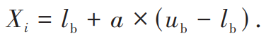
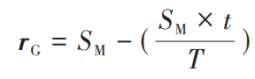

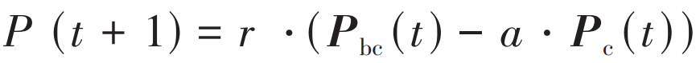
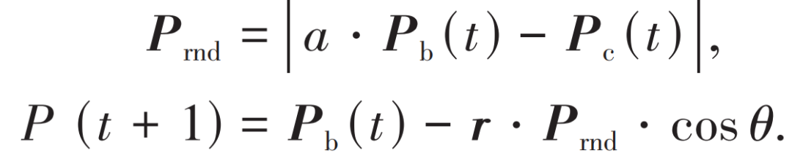
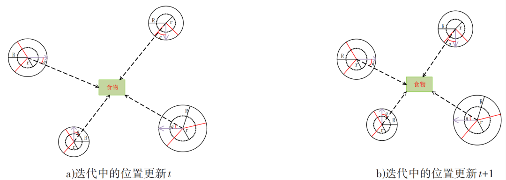
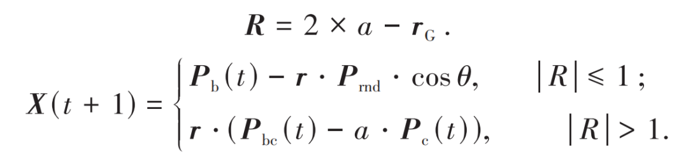

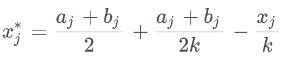
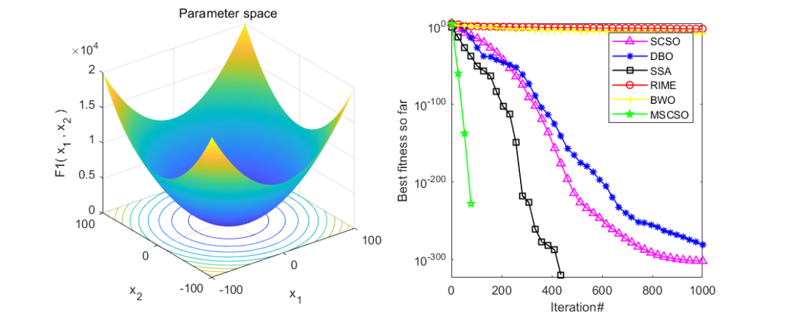
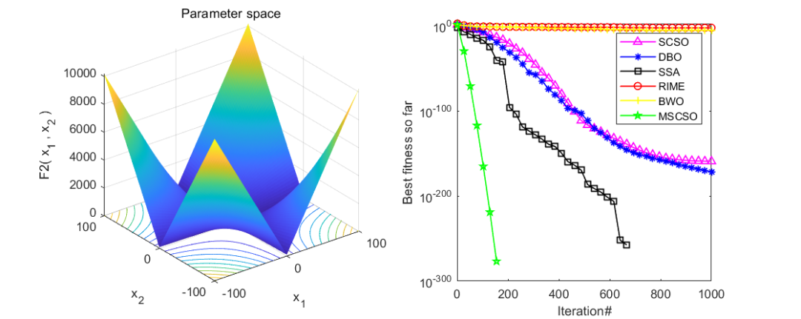
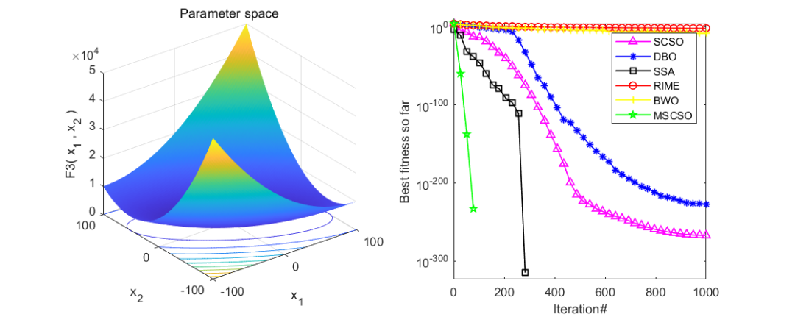
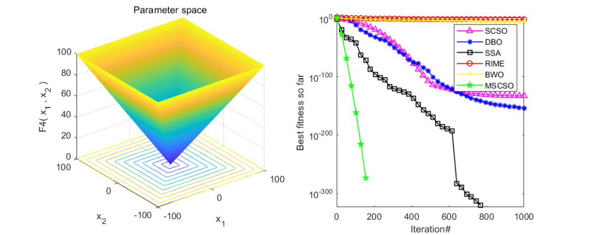
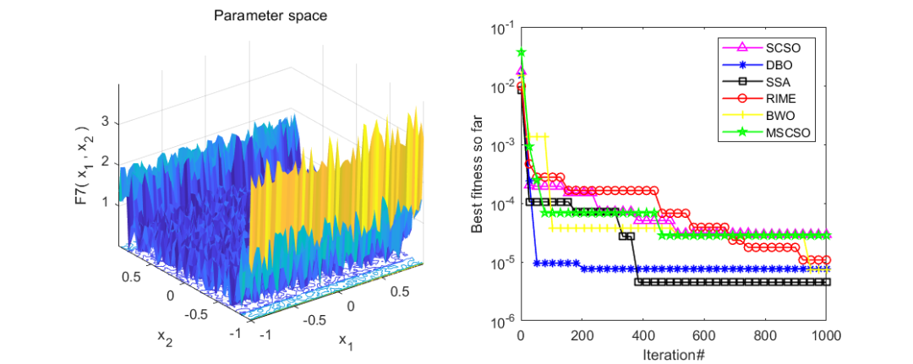
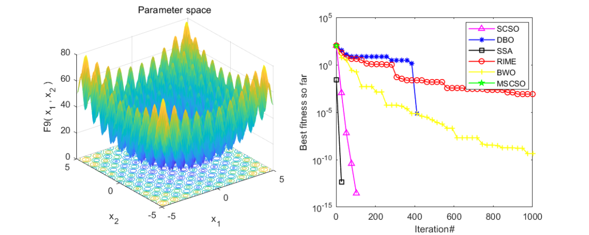
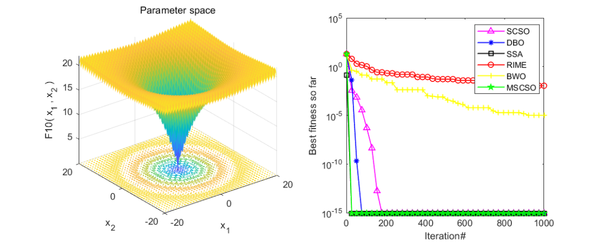

<!-- PAYMENT_BLOCK -->

## Get this dataset

- Payment link (Stripe): [Buy now](https://buy.stripe.com/3cs8yP7sY87d0vu9AB)
- Payment QR code: 

<!-- /PAYMENT_BLOCK -->
